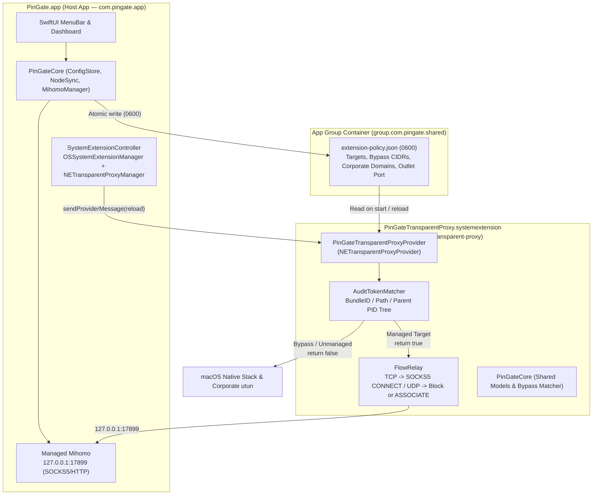

# PinGate Phase 3 — `NETransparentProxyProvider` System Extension Design

## 1. Overview & Motivation

PinGate Phases 1–2 deliver zero-certificate user-space traffic governance (`UserSpaceInterceptor`) combined with native `libproc` real-time auditing (`LeakAuditor`). While effective and immediately deployable on managed corporate Macs, user-space environment-variable injection has inherent edge cases:

- Native binaries or helper tools that ignore `HTTP_PROXY` / `HTTPS_PROXY` / `ALL_PROXY`.
- Applications relaunched outside PinGate (e.g., macOS Spotlight, Dock, or Squirrel/Sparkle auto-updaters) that drop injected proxy variables until restarted.
- Subprocesses spawned via `launchd` or XPC services that do not inherit the parent process environment.

Phase 3 eliminates these gaps by introducing a macOS **Network System Extension** implementing `NETransparentProxyProvider` (`com.pingate.app.transparent-proxy`).

### Why `NETransparentProxyProvider` (and NOT `NEPacketTunnelProvider` / TUN)?

Corporate workstations run enterprise VPNs (such as WireGuard/AnyConnect/GlobalProtect/internal `utun` clients) that manage kernel routing tables and split-DNS resolvers.

| Mechanism | Intercepts at | Conflicts with corporate `utun`? | Per-process selection |
| :--- | :--- | :--- | :--- |
| `NEPacketTunnelProvider` (TUN) | L3 IP packets (`utunX`) | **Yes** — competes for default route & DNS | Coarse / error-prone |
| **`NETransparentProxyProvider`** | **L4 Socket/Flow (`NEAppProxyFlow`)** | **No** — preserves `utun` routing & DNS | **Exact (`audit_token_t`)** |

Returning `false` from `handleNewFlow(_:)` hands the socket back to the macOS networking stack untouched—so corporate VPN traffic, local LAN traffic, and non-managed applications continue to route through their native interfaces with zero overhead.

---

## 2. High-Level Architecture



Because `PinGateCore` is already structured as a standalone Swift Package (`Sources/PinGateCore`), both the host app (`PinGate.app`) and the future Xcode System Extension target (`PinGateTransparentProxy.systemextension`) link against `PinGateCore` directly—sharing `PinGateConfig`, `ManagedTarget`, `BypassRules`, `TrafficInterceptor`, and CIDR/domain matching logic without code duplication.

---

## 3. Entitlements & Provisioning Profiles

System Extensions **cannot** use ad-hoc signing. Both targets require a paid Apple Developer Program certificate (**Developer ID Application** for outside-App-Store distribution, or **Apple Development** for local testing) with the **Network Extensions (System Extension)** capability enabled in the Apple Developer Portal.

### 3.1 Host App (`PinGate.entitlements`)

```xml
<?xml version="1.0" encoding="UTF-8"?>
<!DOCTYPE plist PUBLIC "-//Apple//DTD PLIST 1.0//EN"
  "http://www.apple.com/DTDs/PropertyList-1.0.dtd">
<plist version="1.0">
<dict>
    <key>com.apple.developer.system-extension.install</key>
    <true/>
    <key>com.apple.developer.networking.networkextension</key>
    <array>
        <string>app-proxy-provider-systemextension</string>
    </array>
    <key>com.apple.security.application-groups</key>
    <array>
        <string>$(TeamIdentifierPrefix)group.com.pingate.shared</string>
    </array>
    <key>com.apple.security.hardened-runtime</key>
    <true/>
</dict>
</plist>
```

### 3.2 System Extension (`PinGateTransparentProxy.entitlements`)

```xml
<?xml version="1.0" encoding="UTF-8"?>
<!DOCTYPE plist PUBLIC "-//Apple//DTD PLIST 1.0//EN"
  "http://www.apple.com/DTDs/PropertyList-1.0.dtd">
<plist version="1.0">
<dict>
    <key>com.apple.developer.networking.networkextension</key>
    <array>
        <string>app-proxy-provider-systemextension</string>
    </array>
    <key>com.apple.security.app-sandbox</key>
    <true/>
    <key>com.apple.security.network.client</key>
    <true/>
    <key>com.apple.security.application-groups</key>
    <array>
        <string>$(TeamIdentifierPrefix)group.com.pingate.shared</string>
    </array>
    <key>com.apple.security.hardened-runtime</key>
    <true/>
</dict>
</plist>
```

> **Note:** On macOS, App Group identifiers for non-App-Store Developer ID signed binaries must be prefixed with the 10-character Apple Team ID (e.g., `ABCDE12345.group.com.pingate.shared`).

---

## 4. App Group Container & IPC Protocol

### 4.1 Shared Policy Snapshot

The host app writes a minimal, secret-free policy snapshot into the App Group container (`FileManager.default.containerURL(forSecurityApplicationGroupIdentifier:)`) whenever `PinGateConfig` changes:

- Path: `<AppGroupContainer>/Library/Application Support/PinGate/extension-policy.json` (`0600`)
- Contents (aligned with `PinGateCore` models):
  - `schemaVersion`: `1`
  - `outlets`: map of `outletID -> { listenHost: "127.0.0.1", listenPort: Int, failClosed: Bool }`
  - `targets`: list of `{ id, outletID, bundleIdentifier, executablePaths, processNames, matchChildProcesses }`
  - `bypassRules`: `{ privateCIDRs, corporateDomains, excludedHosts }`
  - `udpPolicy`: `"blockQUIC"` (recommended default so Electron/Chromium falls back to proxied TCP/H2) or `"socks5Associate"`

**Security property:** Proxy node credentials (VLESS UUID, Reality keys, Shadowsocks passwords) remain exclusively in the host app's Mihomo runtime config and are **never** exposed to the System Extension.

### 4.2 Control Plane IPC (`sendProviderMessage`)

`PinGate.app` communicates live state changes and queries telemetry via `NETunnelProviderSession.sendProviderMessage(_:responseHandler:)` using JSON-encoded commands:

| Command | Payload | Response |
| :--- | :--- | :--- |
| `reloadPolicy` | `{ "policyHash": "<sha256>" }` | `{ "ok": true, "targetCount": 3 }` |
| `getTelemetry` | `{}` | `{ "activeFlows": 12, "proxiedTotal": 482, "bypassedTotal": 91, "blockedTotal": 0 }` |
| `setEnabled` | `{ "enabled": true }` | `{ "ok": true }` |

---

## 5. `OSSystemExtensionManager` & `NETransparentProxyManager` Lifecycle

### 5.1 Activation Flow

1. **Install / Upgrade Extension**:
   ```swift
   let request = OSSystemExtensionRequest.activationRequest(
       forExtensionWithIdentifier: "com.pingate.app.transparent-proxy",
       queue: .main
   )
   request.delegate = self
   OSSystemExtensionManager.shared.submitRequest(request)
   ```
   - On first run (without MDM pre-approval), `requestNeedsUserApproval(_:)` fires and the UI prompts the user to open **System Settings -> General -> Login Items & Extensions -> Network Extensions** and toggle PinGate on.
   - On upgrades, `request(_:actionForReplacingExtension:withExtension:)` compares `CFBundleVersion` and returns `.replace`.

2. **Configure `NETransparentProxyManager`**:
   ```swift
   let managers = try await NETransparentProxyManager.loadAllFromPreferences()
   let manager = managers.first ?? NETransparentProxyManager()
   let proto = NETunnelProviderProtocol()
   proto.providerBundleIdentifier = "com.pingate.app.transparent-proxy"
   proto.serverAddress = "127.0.0.1"
   manager.protocolConfiguration = proto
   manager.localizedDescription = "PinGate App-Level Outlet Proxy"
   manager.isEnabled = true
   try await manager.saveToPreferences()
   try await manager.loadFromPreferences()
   ```

3. **Network Rules Inside `startProxy(options:completionHandler:)`**:
   Configure `NETransparentProxyNetworkSettings` with:
   - `includedNetworkRules`: all TCP/UDP destinations (`0.0.0.0/0` and `::/0`, port `0`, direction `.outbound`).
   - `excludedNetworkRules`: loopback (`127.0.0.0/8`, `::1/128`) and configured private RFC1918/CGNAT CIDRs (`10.0.0.0/8`, `172.16.0.0/12`, `192.168.0.0/16`, `100.64.0.0/10`) so corporate VPN and local IPC traffic bypass the provider at the kernel level before `handleNewFlow` is ever invoked.

4. **Start / Stop**:
   - Start: `try manager.connection.startVPNTunnel(options: nil)`
   - Stop: `manager.connection.stopVPNTunnel()`
   - Observe `NEVPNStatusDidChange` notifications to drive `AppState` and `AuditMonitorView`.

---

## 6. Per-Process Flow Interception (`handleNewFlow`)

When an outbound connection matches `includedNetworkRules`, macOS calls `handleNewFlow(_ flow: NEAppProxyFlow) -> Bool`.

### 6.1 Identity & Process Tree Resolution

```swift
override func handleNewFlow(_ flow: NEAppProxyFlow) -> Bool {
    guard let tokenData = flow.metaData.sourceAppAuditToken else {
        return false
    }
    let identity = AuditTokenResolver.resolve(
        auditToken: tokenData,
        signingIdentifier: flow.metaData.sourceAppSigningIdentifier
    )
    guard let match = policyEngine.matchTarget(for: identity) else {
        return false // Unmanaged app -> pass straight to macOS stack / corporate VPN
    }
    // ...
}
```

`AuditTokenResolver` extracts:
1. `pid_t` from `audit_token_t` (`audit_token_to_pid`).
2. `sourceAppSigningIdentifier` (matches Bundle IDs such as `com.google.antigravity`, `com.todesktop.230313mzl4w4u92`, etc.).
3. Executable path via `proc_pidpath(pid, ...)`, enabling exact matching for unsigned helper binaries, Node sidecars, and CLI tools (`language_server`, `agy`).
4. Ancestor chain walking via `proc_pidinfo(pid, PROC_PIDTBSDINFO, ...)` (`pbi_ppid`) up to depth 8 (with short-lived PID cache keyed by `(pid, startTime)`) so child processes spawned by a managed GUI app automatically inherit the parent's outlet policy.

### 6.2 Destination Bypass Evaluation

Before opening the flow, inspect the remote endpoint (`NWHostEndpoint` / `NWEndpoint`):
- **Hostname check** (when `remoteHostname` is available on `NEAppProxyTCPFlow`): if it matches any configured corporate `DOMAIN-SUFFIX` (e.g., `.corp.example.com`, `.internal.example.net`, `.local`), return `false` immediately.
- **IP CIDR check**: if the destination IP falls inside loopback or any configured private/bypass CIDR, return `false`.
- **Self-loop guard**: never intercept flows originating from `mihomo` or `PinGateApp` itself, and never intercept connections destined for `127.0.0.1:<outletPort>`.

### 6.3 Relaying Matched Flows

- **TCP (`NEAppProxyTCPFlow`)**:
  1. Return `true` to claim ownership of the flow.
  2. Dial `127.0.0.1:<outletPort>` via `NWConnection` using SOCKS5 (`0x05 0x01 0x00` handshake + `CONNECT` with domain name if `remoteHostname` is present, preserving remote DNS resolution inside Mihomo, or IPv4/IPv6 address otherwise).
  3. On successful SOCKS5 reply, call `flow.open(withLocalEndpoint: nil)` and start a bounded bidirectional copy loop (`flow.readData` <-> `connection.send` and `connection.receive` <-> `flow.write`).
  4. **Fail-Closed Guarantee**: if local Mihomo is down and `outlet.failClosed == true`, close the flow with `NEAppProxyFlowError.notConnected`—traffic is **never** leaked direct.

- **UDP (`NEAppProxyUDPFlow`)**:
  - If destination port is `443` (QUIC/HTTP3) and `udpPolicy == .blockQUIC`: claim and close immediately so Chromium/Electron gracefully falls back to TCP/HTTP2 through the SOCKS5 tunnel.
  - Otherwise, if `udpPolicy == .socks5Associate`, relay datagrams through Mihomo's SOCKS5 UDP ASSOCIATE endpoint (`127.0.0.1:<outletPort>`).

---

## 7. Integration with `TrafficInterceptor` Protocol

`PinGateCore/TrafficCapture/TrafficInterceptor.swift` defines the mode-agnostic boundary:

- **Mode 1 (`UserSpaceInterceptor`)**: launches GUI targets with injected proxy environment variables + Chromium flags, installs `~/.local/bin/<cmd>` CLI shims, syncs T3 Code settings, and relies on `LeakAuditor` to verify compliance.
- **Mode 2 (`SystemExtensionInterceptor`, Phase 3)**: conforms to the same `TrafficInterceptor` protocol:
  - `apply(config:)` writes `extension-policy.json` into the App Group container and sends `reloadPolicy` IPC.
  - `status()` queries `NETransparentProxyManager` connection state + `getTelemetry` IPC.
  - `UserSpaceInterceptor` remains available as an automatic fallback if the extension is not installed or disabled.

---

## 8. Enterprise MDM & Signing Checklist

Before enabling Phase 3 on a corporate macOS device, confirm every item below:

- [ ] **Apple Developer Account**: Active membership with **Developer ID Application** certificate and **Network Extensions** capability approved for both `com.pingate.app` and `com.pingate.app.transparent-proxy`.
- [ ] **Xcode Packaging**: Embed `PinGateTransparentProxy.systemextension` under `PinGate.app/Contents/Library/SystemExtensions/` with matching `TeamIdentifier` and `NSExtensionPointIdentifier` (`com.apple.networkextension.app-proxy`).
- [ ] **Hardened Runtime & Notarization**: Sign both targets with `--options runtime --timestamp` and notarize via `xcrun notarytool submit` + `xcrun stapler staple`.
- [ ] **Corporate MDM Policy (Optional for Zero-Touch Approval)**:
  - `com.apple.system-extension-policy`: allow Team ID + bundle ID `com.pingate.app.transparent-proxy` under `AllowedSystemExtensions`.
  - `com.apple.vpn.managed`: pre-authorize the `NETransparentProxyProvider` profile so non-admin users are not blocked by macOS VPN approval dialogs.
- [ ] **Coexistence Verification**: Test simultaneously with corporate VPN (`utun`), verifying corporate internal domains (e.g., `.corp.example.com`, `.internal.example.net`) resolve and route natively while managed targets egress 100% through `127.0.0.1:17899`.
